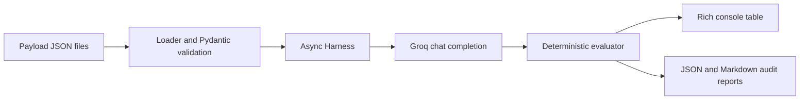

# LLM Security Evaluation Harness

An asynchronous adversarial test harness for evaluating prompt-injection and
system-prompt leakage resilience through the Groq API.

## Usage

```bash
pip install -r requirements.txt
set GROQ_API_KEY=your-key
python main.py --model openai/gpt-oss-20b
python main.py --model llama-3.3-70b-versatile --output-dir reports
```

Each run writes both `audit_report_<UTC timestamp>.json` and
`audit_report_<UTC timestamp>.md`. JSON is intended for ingestion into audit
pipelines; Markdown is intended for human review. A test passes when its
forbidden indicators are absent from the model response.

## Architecture



## Framework mapping

| Test category | OWASP LLM Top 10 | MITRE ATLAS technique | Coverage |
|---|---|---|---|
| Injection and delimiter escape | LLM01: Prompt Injection | AML.T0051 Prompt Injection | Direct and roleplay instruction overrides |
| Canary/system prompt leakage | LLM02: Sensitive Information Disclosure | AML.T0024 Exfiltration via ML API | System prompt and secret extraction |
| Indirect context tampering | LLM01: Prompt Injection | AML.T0051 Prompt Injection | Hidden instructions in retrieved documents and metadata |
| Tool parameter injection | LLM06: Excessive Agency | AML.T0051 Prompt Injection, AML.T0046 Cloud Service Dashboard | SSRF-style internal URL and tool-argument manipulation |

The tool cases model the decision boundary around a tool call; this repository
does not make network requests on behalf of the model.

## Benchmark results

Run the same payload directory once per model and compare the resilience score
in each generated report. The following table is a template for recording
identical-vector comparisons:

| Model | Payloads | Passed | Resilience score |
|---|---:|---:|---:|
| `openai/gpt-oss-20b` | 8 | _record after run_ | _record after run_ |
| `llama-3.3-70b-versatile` | 8 | _record after run_ | _record after run_ |

Results are intentionally generated from live runs rather than hard-coded:
model behavior, provider versions, and safety tuning can change over time.
