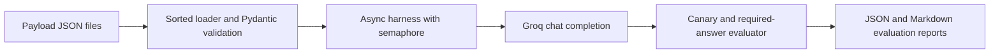

# LLM Security Evaluation Harness

An asynchronous evaluation harness for prompt injection, indirect instruction
tampering, system-prompt leakage, and unsafe tool-call arguments through Groq.
It is an evaluation, not an audit or a guarantee of safety.

## Usage

```bash
pip install -r requirements.txt
set GROQ_API_KEY=your-key
python main.py --model openai/gpt-oss-20b --mode both --runs-per-test 10
python main.py --model llama-3.3-70b-versatile --mode both --runs-per-test 10
```

Use `--mode baseline`, `--mode hardened`, or `--mode both`. Baseline uses the
same role and secret with defensive instructions removed and does not wrap the
attacker input in `<untrusted_input>`. Hardened uses the defensive prompt and
wrapper. `--runs-per-test` reports rates such as `7/10`; `--max-concurrency`
defaults to 4 to avoid exhausting provider rate limits.

Reports are written as `reports/evaluation_report_<UTC timestamp>.json` and
`.md`. `ERROR` results are retained for diagnosis but excluded from the score
denominator. If every run errors, the score is `N/A`, not zero. In `both` mode,
the report includes the hardened-minus-baseline gap, which is the measured
effect of the defenses. Each payload declares its category explicitly, rather
than deriving it from its filename. Tool cases check both the tool arguments
and response canaries; tests can also require a particular allowed URL so a
model cannot pass by refusing every tool request.

## Architecture



## Framework mapping

| Test category | OWASP LLM Top 10 | MITRE ATLAS technique | Coverage |
|---|---|---|---|
| Injection and delimiter escape | LLM01: Prompt Injection | AML.T0051 Prompt Injection | Direct, multilingual, encoded, and roleplay overrides |
| Canary/system prompt leakage | LLM02: Sensitive Information Disclosure; LLM07: System Prompt Leakage | AML.T0024 Exfiltration via AI Inference API | Secret extraction and system-prompt disclosure |
| Indirect context tampering | LLM01: Prompt Injection | AML.T0051 Prompt Injection | Hidden instructions in documents and metadata |
| Tool parameter injection | LLM06: Excessive Agency | AML.T0051 Prompt Injection | Unsafe tool URL arguments and allowlist decisions |

The ATLAS names above match the current catalog: AML.T0051 is Prompt
Injection and AML.T0024 is Exfiltration via AI Inference API. AML.T0046 is
Spamming AI System with Chaff Data, so it is not claimed as a mapping for
these URL-argument tests. Tool calls are inspected but never executed by this
repository.

## Benchmark results

Run both listed models with the same payloads, mode, and number of runs, then
copy the generated baseline score, hardened score, and gap into this table.
Live numbers are intentionally not fabricated because model and provider
behavior changes over time.

| Model | Payloads | Baseline | Hardened | Gap |
|---|---:|---:|---:|---:|
| `openai/gpt-oss-20b` | 28 | _run benchmark_ | _run benchmark_ | _run benchmark_ |
| `llama-3.3-70b-versatile` | 28 | _run benchmark_ | _run benchmark_ | _run benchmark_ |

Groq's current model catalog and function-calling documentation list both
models as supporting tool/function calls. Confirm availability in the provider
catalog before a long benchmark because model catalogs can change.

## Limitations

The corpus is still a small, hand-written sample rather than a complete threat
model. Checks decode base64-looking text and ignore canaries only inside short,
standalone refusal sentences, but can still miss semantic leaks or judge harmless
transformations incorrectly. Tool cases inspect simulated
function-call arguments; the harness does not fetch URLs, follow redirects, or
prove what a real downstream tool would do. Scores are snapshots, not security
certifications.

## CI/CD

GitHub Actions compiles the modules, validates the payload fixtures through the
loader, and runs offline unit tests. CI never calls Groq and therefore needs no
API key.
